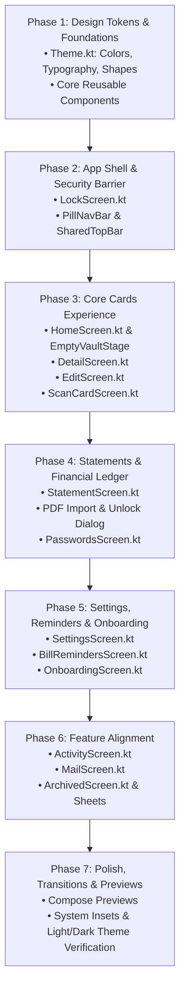

# Implementation Plan: Google Stitch Redesign

This plan outlines the structured, phased roadmap to redesign the **CCManager** Android application to match the **Google Stitch "Private Vault"** design system.

---

## 1. Guiding Principles & Strict Guardrails

1. **Zero Logic Disruption**: No changes to database schemas, SQLCipher encryption keys, repositories (`Repo.kt`, `Ledger.kt`), billing calculation engines (`Billing.kt`), statement parsers (`Parser.kt`), or IMAP clients (`MailClient.kt`).
2. **Preserve UI Framework**: Stay 100% native with **Jetpack Compose** and Kotlin.
3. **Preserve Navigation & Lifecycle**: Keep existing navigation routes, deep links, launcher shortcuts, and Android Biometric security barriers intact.
4. **Reusable Component Architecture**: Construct isolated, reusable Compose components matching the Stitch sticker sheets before updating individual screen composables.
5. **No Premature File Modification**: No changes are applied until the user reviews and explicitly approves this analysis.

---

## 2. Recommended Phased Implementation Order

### Phase 1: Design Tokens, Typography & Component Foundation
- **Goal**: Establish the Stitch "Private Vault" design system foundation in Compose.
- **Tasks**:
  1. Update `Theme.kt`:
     - Add the Obsidian & Champagne Gold color schemes (`darkColorScheme` and `lightColorScheme`) using the exact Stitch tokens.
     - Add typography definitions using Mulish (display/headlines), Instrument Sans (body/labels), and Source Code Pro (monospace numbers & tabular currency).
     - Configure squircle shape tokens (`28dp` for extraLarge, `20dp` for large, `16dp` for medium, `12dp` for small).
  2. Implement reusable Stitch components in `Components.kt`:
     - `VaultTopAppBar` (frosted sticky header with backdrop blur and hairline border).
     - `VaultPrimaryButton`, `VaultIconButton`, `VaultTonalButton`.
     - `VaultFilterChip` (filter pill with active fill/border state).
     - `VaultCardContainer` & `VaultBentoTile`.
     - `CircularUtilizationGauge` (64dp Canvas arc meter).
     - `ProportionalSpendBar` (segmented categorical spend bar).
     - `MaskedCardNumber` & `TabularCurrencyText`.
     - `UrgencyBadge` (`2d left`, `Due 28 Nov`).

### Phase 2: Shell & Security Barrier
- **Goal**: Redesign the outer shell and the app's biometric gatekeeper.
- **Tasks**:
  1. `LockScreen.kt`: Redesign with concentric glowing rings, fingerprint glyph, security assurance cards ("Completely offline vault", "Biometric reveal"), and bottom "Unlock Vault" pill button.
  2. `NavBar.kt`: Refine `PillNavBar` into the floating glass capsule dock matching Stitch spacing and tonal elevation.
  3. `TabHeader.kt`: Refine `SharedTopBar` into the frosted translucent top bar with brand badge, owner title, and quick action buttons.

### Phase 3: Core Cards Experience
- **Goal**: Redesign the main card management flow.
- **Tasks**:
  1. `HomeScreen.kt`:
     - **Cards Feed**: Wealth Editorial Header with total outstanding balance and circular utilization gauge.
     - **Category Filter**: `All`, `Credit`, `Debit` pill chips.
     - **Physical Card Feed**: Authentic brand surfaces with chip, contactless symbol, and current due amounts.
     - **Upcoming Bills Carousel**: Horizontal cards with urgency tags (`2d left`).
     - **Empty Vault State**: Blueprint card visual with scanning beam, welcome copy, and `CardLaunchpadDock`.
  2. `DetailScreen.kt`:
     - Hero card with inline "Reveal CC" pill and countdown timer.
     - Asymmetric Due & Limit Bento Grid with "Mark as paid" action and credit utilization bar.
     - Specs & reminder strip (billing cycle, synced statements, reminder toggle).
     - Statements history list with "Fetched from email" badges.
  3. `EditScreen.kt`:
     - Miniature 3D card preview with "Design" button.
     - Quick actions for "Scan card" and "Tap card (NFC)".
     - Grouped form panels: Card details, Statement & due dates, Limits & notes.
  4. `ScanCardScreen.kt`:
     - Viewfinder with 1.58:1 aspect reticle, corner brackets, animated laser line, and verified card emblem upon successful scan.

### Phase 4: Statements & Financial Ledger
- **Goal**: Redesign statement details, PDF unlocking, and security credentials.
- **Tasks**:
  1. `StatementScreen.kt`:
     - Statement summary card with due date urgency badge and minimum due.
     - Proportional spend breakdown bar with ranked category list.
     - Category filter pills (`All`, `Dining`, `Travel`, `Groceries`).
     - Two-line transaction list rows with category icons and tabular figures.
  2. `ImportFix.kt` / Statement Unlock:
     - Multi-step PDF password dialog matching `upload_unlock_statement/code.html` with bank password hints, saved pattern autofill, and "Remember password" toggles.
  3. `PasswordsScreen.kt`:
     - Protected by biometric lock cover shield.
     - Personal details card (Name, DOB, PAN, Mobile) for automatic password generation.
     - Extra pattern input and remembered password list with delete controls.

### Phase 5: Settings, Reminders & Onboarding
- **Goal**: Redesign settings, notifications preview, and onboarding experience.
- **Tasks**:
  1. `SettingsScreen.kt`:
     - User identity block with initials avatar and privacy status.
     - Multi-account Gmail statement sync list and empty state.
     - Security & reminders grouped list.
     - Theme selector and data backup controls.
  2. `BillRemindersScreen.kt`:
     - Android notification shade simulator with BigPictureStyle preview and action buttons ("Mark as paid", "Remind tomorrow").
     - Lead time selection controls.
  3. `OnboardingScreen.kt`:
     - 3-step carousel with segmented progress rail.
     - Page 1: Floating 3-card deck visual & value proposition.
     - Page 2: Smart Due Radar visual & permission request capsules.
     - Page 3: Instant Launchpad (Scan, Tap, Type).

### Phase 6: Remaining Screen & Sheet Alignment
- **Goal**: Harmonize unstyled features to ensure visual uniformity across the app.
- **Tasks**:
  1. `ActivityScreen.kt`: Style transactions feed, monthly groups, search, and category chips using Private Vault design tokens.
  2. `MailScreen.kt`: Align account credentials, sync logs, and app password instructions with Stitch grouped container styles.
  3. `ArchivedScreen.kt`: Display archived cards in the miniature card format with restore/delete actions.
  4. Secondary sheets (`BankSheet.kt`, `DesignSheet.kt`, `NameSheet.kt`, `TapCardSheet.kt`): Update squircle sheet containers and interactive controls.

### Phase 7: Verification & Quality Assurance
- **Goal**: Verify visual fidelity, accessibility, performance, and functionality.
- **Tasks**:
  1. Verify Compose Previews for every screen in both Light and Dark modes.
  2. Verify edge-to-edge system bar insets (status bar and navigation bar padding).
  3. Perform compile and test verification (`gradle testDebugUnitTest`).
  4. Verify hardware interactions on device/emulator (Biometrics, CameraX scanner, NFC).

---

## 3. Files Impact Analysis

### 3.1 Files That Will Be Modified (UI Layer Only)
- `app/src/main/java/com/devanandsb/ccmanager/ui/Theme.kt`
- `app/src/main/java/com/devanandsb/ccmanager/ui/Components.kt`
- `app/src/main/java/com/devanandsb/ccmanager/ui/HomeScreen.kt`
- `app/src/main/java/com/devanandsb/ccmanager/ui/DetailScreen.kt`
- `app/src/main/java/com/devanandsb/ccmanager/ui/EditScreen.kt`
- `app/src/main/java/com/devanandsb/ccmanager/ui/ScanCardScreen.kt`
- `app/src/main/java/com/devanandsb/ccmanager/ui/StatementScreen.kt`
- `app/src/main/java/com/devanandsb/ccmanager/ui/ImportFix.kt`
- `app/src/main/java/com/devanandsb/ccmanager/ui/PasswordsScreen.kt`
- `app/src/main/java/com/devanandsb/ccmanager/ui/BillRemindersScreen.kt`
- `app/src/main/java/com/devanandsb/ccmanager/ui/SettingsScreen.kt`
- `app/src/main/java/com/devanandsb/ccmanager/ui/LockScreen.kt`
- `app/src/main/java/com/devanandsb/ccmanager/ui/OnboardingScreen.kt`
- `app/src/main/java/com/devanandsb/ccmanager/ui/NavBar.kt`
- `app/src/main/java/com/devanandsb/ccmanager/ui/TabHeader.kt`
- `app/src/main/java/com/devanandsb/ccmanager/ui/ActivityScreen.kt`
- `app/src/main/java/com/devanandsb/ccmanager/ui/MailScreen.kt`
- `app/src/main/java/com/devanandsb/ccmanager/ui/ArchivedScreen.kt`
- `app/src/main/java/com/devanandsb/ccmanager/ui/CardFace.kt`
- `app/src/main/java/com/devanandsb/ccmanager/ui/CardArt.kt`
- `app/src/main/java/com/devanandsb/ccmanager/ui/BankSheet.kt`
- `app/src/main/java/com/devanandsb/ccmanager/ui/DesignSheet.kt`
- `app/src/main/java/com/devanandsb/ccmanager/ui/TapCardSheet.kt`
- `app/src/main/java/com/devanandsb/ccmanager/ui/NameSheet.kt`

### 3.2 Files That Must Remain Strictly Untouched

| Layer | Files | Reason |
| :--- | :--- | :--- |
| **Database & Room** | `AppDatabase.kt`, `Entities.kt`, `CardDao.kt`, `LedgerDao.kt`, `BinDao.kt`, `BinEntry.kt`, `BackupDao.kt`, `Backup.kt` | Preserves existing database schemas, migrations, table relations, and local data integrity. |
| **Repositories** | `Repo.kt`, `Ledger.kt`, `Prefs.kt` | Preserves business contracts, Flow/StateFlow streams, and DataStore settings. |
| **Domain Calculations** | `Billing.kt`, `BinLookup.kt`, `Format.kt`, `Issuers.kt` | Preserves due date algorithms, statement cycle math, and offline card BIN resolution. |
| **Statement Ingestion** | `MailClient.kt`, `StatementSync.kt`, `Parser.kt`, `Passwords.kt`, `Pdf.kt`, `SliceParser.kt`, `UnityParser.kt`, `SyncWorker.kt` | Preserves IMAP Gmail integration, regex bank parsers, and PDF text extraction. |
| **Cryptographic Security** | `Auth.kt`, `Vault.kt`, `Keys.kt`, `DbKey.kt` | Preserves Android Keystore hardware keys and SQLCipher database passphrases. |
| **Hardware Interop** | `EmvReader.kt`, `CardText.kt` (regex parser engine) | Preserves NFC APDU protocol engine and ML Kit text recognition patterns. |
| **System Integrations** | `CardAutofillService.kt`, `AutofillUnlockActivity.kt`, `CardFields.kt`, `Notifications.kt`, `Reminders.kt`, `Receivers.kt`, `SweepWorker.kt` | Preserves Android Autofill service and AlarmManager reminder triggers. |

---

## 4. Verification & Testing Strategy

1. **Static Analysis & Compilation**:
   - Run `gradle testDebugUnitTest` to guarantee all domain and parsing tests continue passing.
   - Run `studio_analyze_file` across all modified Compose files to ensure zero lint errors, missing imports, or type mismatches.
2. **Visual Fidelity Verification (Compose Previews)**:
   - Provide `@Preview` annotations for each redesigned component and screen for both Light Mode and Dark Mode.
   - Verify squircle radii (`28dp` / `20dp`), frosted toolbar translucency, and font tracking.
3. **Behavioral & Interaction Verification**:
   - Verify biometric lock barrier (`LockScreen`) triggers BiometricPrompt on unlock without allowing back gesture bypass.
   - Verify physical card flip animation and 15s credentials reveal timer on `DetailScreen`.
   - Verify CameraX viewfinder reticle and OCR scanning completion on `ScanCardScreen`.
   - Verify PDF statement password unlock flow on `ImportFix`.
   - Verify horizontal and vertical scroll physics, and smooth shared card element transitions between Home and Detail views.
