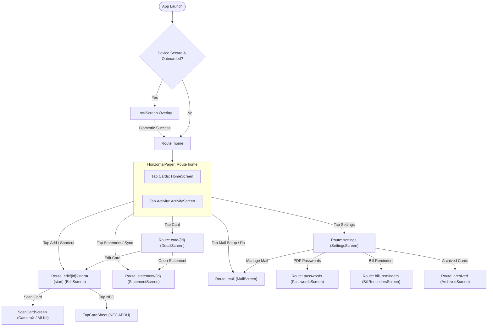

# Project Analysis: CCManager (Private Vault)

## 1. Executive Summary

**CCManager** (branded as **Private Vault**) is an offline-first, privacy-focused native Android application built entirely with **Kotlin** and **Jetpack Compose**. It provides secure credit and debit card management, EMV/NFC and OCR card ingestion, and encrypted monthly statement reading with automated expense categorization and bill reminder scheduling.

The application follows clean architecture principles with strict data containment: all sensitive credentials (card numbers, CVVs, statement passwords, personal identification) are encrypted on-device via SQLCipher and Android Keystore, with zero cloud dependency.

---

## 2. Technology Stack & Dependencies

| Layer | Technologies / Libraries |
| :--- | :--- |
| **Language & Platform** | Kotlin 2.x, Android SDK (minSdk: 26, compileSdk: 36, targetSdk: 36), Java 17 |
| **UI Framework** | **Jetpack Compose** (BOM `2025.09.00`), Material 3 (`androidx.compose.material3:material3`) |
| **Navigation** | Jetpack Navigation Compose (`androidx.navigation:navigation-compose:2.9.0`) |
| **Local Database** | Room 2.7.1 (`androidx.room:room-runtime`, `androidx.room:room-ktx`) |
| **Encryption** | SQLCipher 4.6.1 (`net.zetetic:sqlcipher-android:4.6.1@aar`) + SQLite KTX |
| **Hardware & Security** | AndroidX Biometric 1.1.0 (`androidx.biometric:biometric`), Android Keystore (AES-GCM-256) |
| **Background Work** | AndroidX WorkManager 2.10.0 (`androidx.work:work-runtime-ktx`) |
| **Card Capture** | CameraX 1.4.2 (`camera-camera2`, `camera-lifecycle`, `camera-view`), Google ML Kit Text Recognition 16.0.1, NFC ISO-DEP APDU Reader |
| **Statement Ingestion** | Android Mail (JavaMail 1.6.7) via IMAP SSL, PDFBox Android (`com.tom-roush:pdfbox-android:2.0.27.0`) |
| **System Integrations** | Android Autofill Framework (`CardAutofillService`), Launcher App Shortcuts, Predictive Back |

---

## 3. Existing Project Architecture

The project is structured according to clear architectural boundaries across packages:

```
com.devanandsb.ccmanager/
├── CardsApp.kt              # Application subclass; initializes SQLCipher, Database, Repos, WorkManager
├── MainActivity.kt          # Single-activity host for Compose NavHost, biometric lifecycle & shortcuts
├── autofill/                # Android Autofill framework integration
│   ├── CardAutofillService.kt
│   ├── AutofillUnlockActivity.kt
│   └── CardFields.kt
├── capture/                 # Hardware card ingestion
│   ├── CardText.kt          # ML Kit on-device regex card extraction
│   └── EmvReader.kt         # ISO-DEP NFC APDU card interrogator
├── data/                    # Room Database, SQLCipher encryption & DAOs
│   ├── AppDatabase.kt       # RoomDatabase with 13 schema versions & migrations
│   ├── Entities.kt          # Card, Statement, Txn, Category, MailSource, Payment
│   ├── CardDao.kt           # Card CRUD, pins, archive queries
│   ├── LedgerDao.kt         # Statements, transactions, categories, and sync logs
│   ├── BinDao.kt & BinEntry.kt # Offline BIN cache
│   ├── BackupDao.kt & Backup.kt# Encrypted JSON backup/restore
│   ├── Prefs.kt             # DataStore / SharedPreferences wrapper
│   └── Repo.kt & Ledger.kt  # Repository pattern exposing StateFlow/Flow
├── domain/                  # Business logic & calculations
│   ├── Billing.kt           # Statement cycle & due date calculation engine
│   ├── BinLookup.kt         # 13,000+ line offline BIN CSV lookup
│   ├── Format.kt            # Indian Rupee (₹) tabular currency & date formatting
│   └── Issuers.kt           # Bank identification, colors, and regex rules
├── ingest/                  # Statement processing engine
│   ├── MailClient.kt        # Direct IMAP client over SSL (Gmail statement fetcher)
│   ├── StatementSync.kt     # Statement ingestion pipeline & coordinator
│   ├── Parser.kt            # Regex parsers for 15+ Indian bank statements
│   ├── Passwords.kt         # Password guessing algorithms based on user profile
│   ├── Pdf.kt               # PDFBox text extraction
│   ├── SliceParser.kt & UnityParser.kt # Bank-specific parsers
│   └── SyncWorker.kt        # Periodic WorkManager background sync
├── reminders/               # Due date notification subsystem
│   ├── Notifications.kt     # Android Notification channels & BigPictureStyle builders
│   ├── Reminders.kt         # AlarmManager scheduling for payment leads
│   ├── Receivers.kt         # BroadcastReceivers for boot & reminders
│   └── SweepWorker.kt       # Background sweep for statement checks
├── security/                # Cryptographic foundation
│   ├── Auth.kt              # BiometricPrompt & Device Credential manager
│   ├── Vault.kt             # Android Keystore hardware-backed AES encryption
│   ├── Keys.kt              # Key generation & attestation
│   └── DbKey.kt             # SQLCipher passphrase derivation
└── ui/                      # Jetpack Compose UI layer
    ├── Theme.kt             # Compose Theme, dynamic Palettes, Typography
    ├── MainActivity.kt      # NavHost, route definitions, top-level sheets
    ├── HomeScreen.kt        # Home screen with Card feed & Upcoming carousel
    ├── ActivityScreen.kt    # Transactions & statements activity list
    ├── DetailScreen.kt      # Single card details, credentials reveal, statement history
    ├── EditScreen.kt        # Card creation & editing with live preview
    ├── ScanCardScreen.kt    # CameraX + ML Kit card scanner screen
    ├── StatementScreen.kt   # Statement breakdown, categories, spend analysis
    ├── MailScreen.kt        # Gmail IMAP sync configuration and logs
    ├── PasswordsScreen.kt   # PDF statement unlock passwords
    ├── BillRemindersScreen.kt # Bill notification lead times & preview
    ├── SettingsScreen.kt    # App settings & preferences
    ├── LockScreen.kt        # Biometric lock overlay
    ├── OnboardingScreen.kt  # First-run 3-step carousel
    ├── ArchivedScreen.kt    # Archived card management
    └── ... (Sheets, Pickers, Components)
```

---

## 4. UI Framework & Navigation Model

### 4.1 UI Framework: Jetpack Compose
- **Single Activity**: `MainActivity` serves as the sole platform host, using `enableEdgeToEdge()` and setting `WindowManager.LayoutParams.FLAG_SECURE` to prevent screen capture in recents or screenshots.
- **Compose Material 3**: Uses Material 3 components (`Scaffold`, `ModalBottomSheet`, `HorizontalPager`, `Surface`, etc.) with customized typography, shapes, and colors.
- **Shared Transitions**: Incorporates `SharedTransitionLayout` (`androidx.compose.animation:animation`) and `Modifier.sharedCard` so physical card faces smoothly animate between Home and Detail views.
- **Theme System**: Custom `CardsTheme` supporting dynamic dark/light theme switching and multi-palette selection (Imperial Indigo, Royal Sapphire, Deep Violet, Racing Emerald, Azure Crystal, Rose Copper, Rose Diamond, Brushed Platinum).

### 4.2 Navigation Architecture
Navigation is powered by `navigation-compose` with the following route hierarchy:



---

## 5. API & External Integrations

1. **Zero Cloud Database**: There is **no remote API server**, no tracking, and no external card API. All card records and balances reside purely in local encrypted SQLite.
2. **Gmail IMAP Sync**: Connects directly via `imaps://imap.gmail.com:993` with TLS/SSL using standard JavaMail. Users can authenticate using Google App Passwords or account credentials to fetch bank statement emails locally.
3. **Android Biometrics**: Uses `BiometricPrompt` with `BIOMETRIC_STRONG` or device credential fallback (PIN/Pattern).
4. **Android Autofill**: Exposes a system autofill service for credit card forms across other applications.
5. **Local ML Kit OCR & NFC**: Operates fully on-device without network calls.
