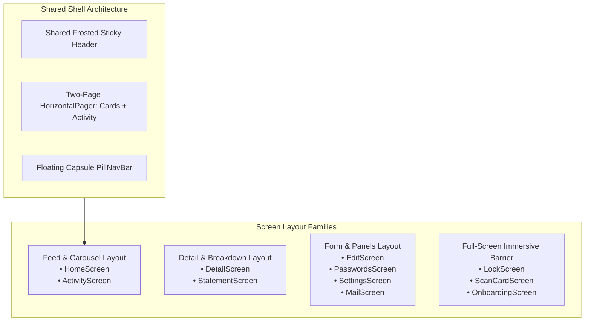

# Screen Mapping & Gap Analysis

This document cross-references every screen in the existing Android project with its corresponding Google Stitch design template, identifies gaps, lists reusable UI components, and highlights shared layouts.

---

## 1. Master Screen-to-Design Mapping

| # | Existing Android File / Screen | Stitch Design Template | Mapping Status | Key Design & Architectural Highlights |
| :-: | :--- | :--- | :---: | :--- |
| **1** | `HomeScreen.kt` `(Tab.Cards)` | `cards_home/code.html` | **Direct Match** | • Total Outstanding wealth summary with circular utilization gauge. • Filter chips: `All`, `Credit`, `Debit`. • Edge-to-edge physical card feed with brand gradients. • Horizontal upcoming bills carousel with urgency badges (`2d left`). • Frosted sticky header with brand eyebrow & owner name. |
| **2** | `HomeScreen.kt` `(EmptyVaultStage)` | `empty_vault_home/code.html` | **Direct Match** | • Blueprint card visual with scanning beam. • Welcome copy & privacy reassurance. • `CardLaunchpadDock`: Scan card (primary CTA), Tap NFC, Type details. • Privacy guarantee feature pills. |
| **3** | `DetailScreen.kt` `("card/{id}")` | `card_detail_redesigned/code.html` | **Direct Match** | • Physical card hero with inline "Reveal CC" pill & 15s timer. • Asymmetric Due & Limit Bento Grid (Mark as paid CTA + utilization bar). • Billing cycle, synced statements, reminder toggle strip. • Statement import action banner. • Statements history list with "Fetched from email" badges. |
| **4** | `EditScreen.kt` `("edit/{id}?start={start}")` | `add_edit_card/code.html` | **Direct Match** | • Live miniature 3D card preview with quick "Design" sheet trigger. • Quick input actions: Scan card & Tap NFC. • Grouped panels: 1. Card details, 2. Statement & due dates, 3. Limits & notes. • Auto-detection of card network and bank styling. |
| **5** | `ScanCardScreen.kt` | `scan_card/code.html` | **Direct Match** | • Top camera controls (Flash, Close, "ON-DEVICE SCANNER" badge). • Center 1.58:1 aspect reticle with 4 corner brackets & laser sweep animation. • Verified card emblem overlay upon successful ML Kit OCR detection. • Primary "Done" and secondary "Scan another card" actions. |
| **6** | `StatementScreen.kt` `("statement/{id}")` | `statement/code.html` | **Direct Match** | • Frosted top bar with email source badge. • Statement overview card (Total due, Min due, Cycle dates, Credit limit). • "Where you spent most" proportional spend breakdown bar + ranked categories. • Category quick filter pills. • Categorized transaction rows with category icons and tabular currency figures. |
| **7** | `ImportFix.kt` `StatementScreen.kt` (PDF Unlock) | `upload_unlock_statement/code.html` | **Direct Match** | • Step 1: Uploaded PDF file card (filename, file size, status badge). • Step 2: Password prompt with bank password format hint & saved pattern chip. • Step 3: "Remember password for this card" & "Apply to all statements" toggles. • Bottom "Unlock & Import" primary CTA. |
| **8** | `PasswordsScreen.kt` `("passwords")` | `pdf_passwords_security/code.html` | **Direct Match** | • Biometric lock cover shield before unlocking sensitive profile info. • "Locked safely on your phone" privacy banner. • Personal details form (Name, DOB, PAN, Mobile) used for automatic PDF unlocking. • Custom bank password patterns input field. • Remembered passwords list with delete actions. |
| **9** | `BillRemindersScreen.kt` `("bill_reminders")` | `bill_reminder_notifications/code.html` | **Direct Match** | • Android notification shade simulation. • BigPictureStyle expanded preview showing card art, due date, and quick action buttons ("Mark as paid", "Remind tomorrow"). • Collapsed notification view. • Lead time configuration options (1 day, 2 days, 3 days, 5 days). |
| **10** | `SettingsScreen.kt` `("settings")` | `settings/code.html` | **Direct Match** | • User identity block with initials avatar and privacy guarantee. • Gmail statement sync section (Multiple connected accounts + empty state preview). • Security & reminders section (Biometric lock toggle, shortcuts to Passwords & Reminders). • Theme selector and data backup controls. |
| **11** | `LockScreen.kt` | `vault_lock/code.html` | **Direct Match** | • Brand eyebrow & "PRIVATE VAULT" shield icon. • Concentric glowing rings around biometric sensor. • Reassuring on-device security guarantee card ("Completely offline vault", "Biometric reveal"). • Bottom "Unlock Vault" pill button. |
| **12** | `OnboardingScreen.kt` | `onboarding_welcome/code.html` & `onboarding_smart_due_radar/code.html` | **Direct Match** | • Segmented progress rail (Page 1 of 3, 2 of 3, 3 of 3). • Page 1: Floating 3-card deck visual, value proposition, 2x1 bento features. • Page 2: Smart Due Radar illustration, upcoming bill capsule, notification & alarm permission request capsules. • Page 3: Instant Launchpad (Scan, Tap, Type). |

---

## 2. Identified Gap Analysis: Existing Screens Requiring Design Adaptation

The following screens exist in the app's current feature set and must be preserved without losing functionality, but do not have dedicated templates in the Stitch zip package:

### 2.1 `ActivityScreen.kt` (Tab.Activity in Home Pager)
- **Current State**: Displays a continuous feed of all synced transactions and statements, monthly spend group headers, category filters, a live search bar, and statement status indicators.
- **Design Adaptation Strategy**:
  - Adopt the **Private Vault** styling:
    - Frosted top bar using the shared `SharedTopBar`.
    - Category filter pills matching `statement/code.html`.
    - Transaction rows using `list-two-line` from Stitch (`@components/list.html`), with category colored icon squares, tabular Rupee figures, and date subtitles.
    - Synchronized with the bottom `PillNavBar`.

### 2.2 `MailScreen.kt` ("mail")
- **Current State**: Manages Gmail IMAP accounts, guides the user on generating Google App Passwords, initiates manual statement sync, and displays the import log with fix actions for failed PDF parses.
- **Design Adaptation Strategy**:
  - Unify with `settings/code.html`'s "Gmail accounts" section.
  - Style the sync status card, app password instruction accordion, and import log items using Stitch's grouped container (`rounded-lg`, `border-dark-outline-variant/40`, `divide-y`) and status badges (`D1F7E3` for success, `FFDAD6` for password needed).

### 2.3 `ArchivedScreen.kt` ("archived")
- **Current State**: Lists archived cards with unarchive/restore and delete options.
- **Design Adaptation Strategy**:
  - Apply the miniature card preview style from `add_edit_card/code.html` (112px height) with monochrome/grayscale overlay, paired with `VaultButton` actions for Restore and Delete.

### 2.4 Modal Sheets & Secondary Dialogs
- `BankSheet.kt` (Bank picker): Adapt to a 28dp squircle bottom sheet with bank logo list and search.
- `DesignSheet.kt` (Card color & art picker): Adapt to a fluid color swatch grid matching Stitch brand colors.
- `NameSheet.kt` / `PersonalizeOwnerSheet.kt`: Adapt to Stitch's input field and rounded pill button styles.
- `TapCardSheet.kt` (NFC reading dialog): Style with the concentric rings NFC animation matching `vault_lock/code.html`.

---

## 3. Reusable UI Component Inventory

To ensure complete design consistency and avoid code duplication, the following reusable Compose components will be created:

| Component Name | Source Stitch Component | Description & Parameters |
| :--- | :--- | :--- |
| `VaultTopAppBar` | `header` in all Stitch screens | Sticky frosted translucent top bar with 80% opacity, backdrop blur, hairline border, navigation icon, title, and trailing actions. |
| `VaultPrimaryButton` | `button-primary` | Full-width or inline rounded pill button (`rounded-full`) in Champagne Gold (`#EAC083`) / Deep Obsidian (`#171B27`). |
| `VaultIconButton` | `button-icon` | 40x40dp circular frosted button (`rounded-full`) with 0.6dp hairline border. |
| `VaultFilterChip` | `chip-filter-selected` / `chip-action` | Rounded pill chip (`rounded-full`) with active fill or subtle outline inactive state. |
| `VaultCardContainer` | Grouped container (`rounded-lg` / `rounded-xl`) | Standard surface container (`surfaceContainer` / `surfaceContainerLowest`) with 20dp/28dp squircle radius and 0.6dp outline variant border. |
| `VaultBentoTile` | Bento grid tiles | Asymmetric 2-column or 2x1 grid tile for metrics, due dates, and limits. |
| `CircularUtilizationGauge` | Utilization gauge (64dp) | Canvas-based animated circular progress meter with central percentage display. |
| `ProportionalSpendBar` | Spend breakdown bar | Multi-segment rounded horizontal progress bar visualizing category spend percentages. |
| `MaskedCardNumber` | Monospace credential | Formatted `•••• •••• •••• 4321` using `Source Code Pro` with tracking and privacy toggle. |
| `UrgencyBadge` | Status pill (`2d left`, `Due 28 Nov`) | Compact badge colored with semantic tokens (Error, Warning, Success). |
| `PhysicalCardFace` | Card Feed / Detail Hero | Realistic squircle card representation with authentic gradient, logos, chip, and typography. |
| `PillNavBar` | Shell dock | Floating glass capsule bottom navigation with spring-animated selected tab indicator. |

---

## 4. Shared Layouts & Structural Parity

- **Family A (Feed & Carousel)**: Characterized by an editorial wealth summary at the top, a horizontal filter pill row, and a vertical scrolling list of primary items followed by horizontal carousels.
- **Family B (Detail & Metrics)**: Characterized by a hero card visual, an asymmetric bento grid for primary financial metrics, and a sectioned history list.
- **Family C (Form & Panels)**: Characterized by an overview preview element at the top, followed by numbered or grouped `VaultCardContainer` panels containing labeled text inputs with mono fonts.
- **Family D (Immersive Flow)**: Characterized by full-screen dark canvas, centered graphical centerpiece (rings, viewfinder, or deck), and bottom sticky full-width pill action buttons.
